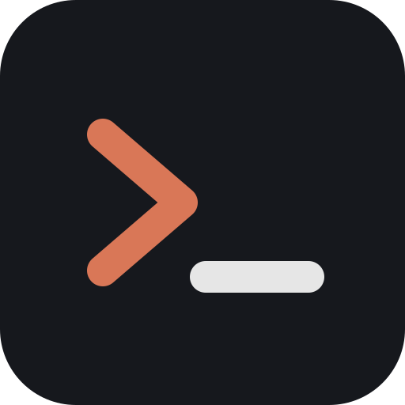
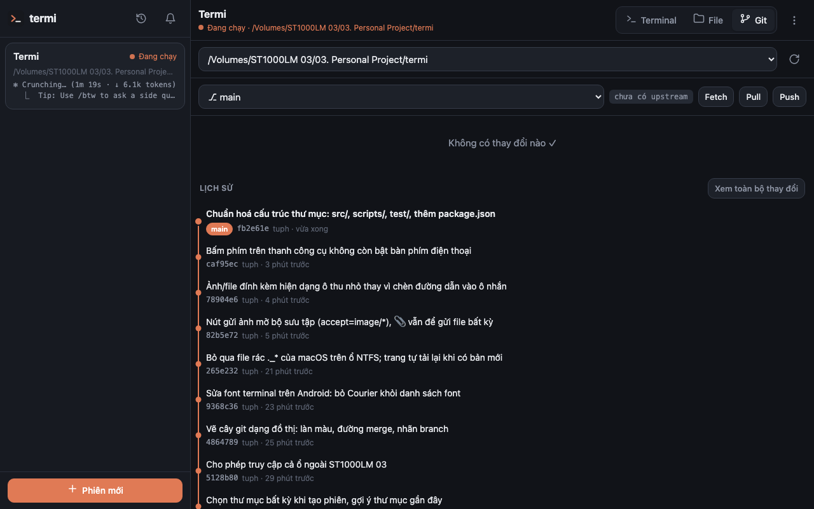
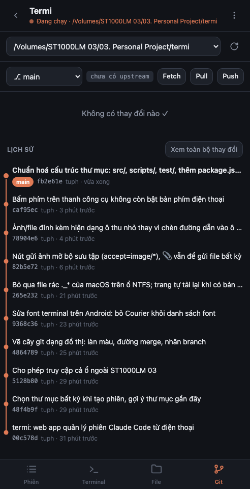
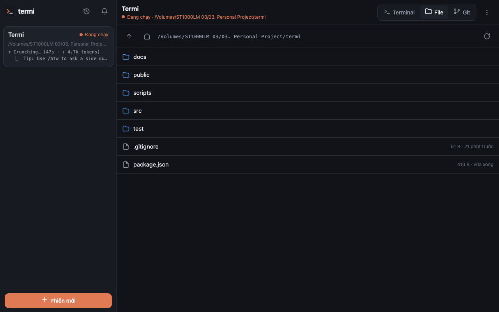
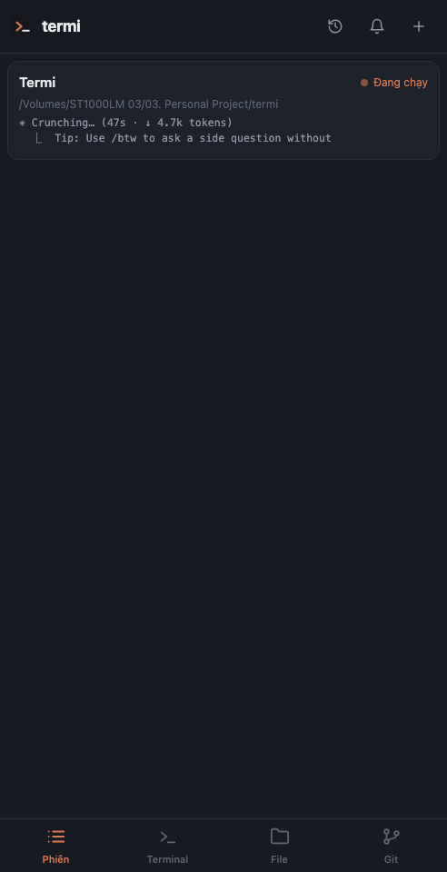
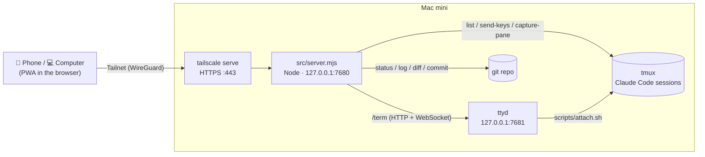

<div align="center">



# termi

**Control Claude Code on your Mac from your phone: sessions that never die, comfortable Vietnamese typing, git at your fingertips.**

<p>
  
  
  
  
  
</p>
<p>
  
  
  
  
  
  
</p>

<sub>No framework · no <code>npm install</code> · no build step</sub>

English | [Tiếng Việt](README.vi.md)

</div>

---

## Why termi?

Using the Claude Code CLI through an SSH app on a phone is painful: lose the network and you lose the session, the on-screen keyboard cannot type Vietnamese, and there is no quick way to check git or see which sessions are running.

termi is a small web app that runs on your own Mac and is opened from your phone (Android and iOS) over Tailscale:

- **Sessions never die:** every Claude session runs inside `tmux`; the app is only a view. Close the app, lose signal or lock the phone, and the session is still there.
- **Vietnamese typing:** the message box uses the phone's native keyboard (Gboard, Laban Key…) and sends the whole text to Claude with bracketed paste.
- **Know what Claude is doing:** a *Working / Waiting for you / Idle* state for each session, plus push notifications when Claude finishes or needs you to approve a command.

## Screenshots

<table>
  <tr>
    <td width="68%"></td>
    <td></td>
  </tr>
  <tr>
    <td></td>
    <td></td>
  </tr>
</table>

## Features

| | Feature | Details |
|---|---|---|
| 🖥️ | **Multiple machines** | Control every machine on the same Tailscale account that runs termi (Mac, Linux, Windows via WSL) from one app: pick the machine at the top of the sidebar; notifications from all machines land in one place. |
| 🤖 | **Multiple agents** | Claude Code, Codex, Antigravity (`agy`): choose the agent when creating a session (only installed agents are shown), automatic detection of which agent a session is running, per-agent state and notifications. |
| 🗂️ | **Session management** | The welcome screen quickly starts a Claude/Codex session in a recent folder; the list puts sessions that need attention first, supports search, groups by folder, and long-press to rename/close; create a session in any folder, rename, close, and resume old Claude (`claude --resume`) and Codex (`codex resume`) conversations. |
| 💻 | **Terminal** | A full terminal (ttyd + xterm.js) attached to the tmux session; swipe to scroll history, the 📋 Copy button opens the session text as plain text for selecting and copying, A−/A+ font size, an Esc, ⇧Tab, ^C, arrow… key row for phones; reconnects automatically or with a tap after a disconnect. |
| ⚡ | **Quick actions** | One tap sends a prepared request to Claude: git status, commit, push, create PR, merge PR (checks CI first), review, run tests, `/compact`; risky actions ask for confirmation. |
| ✍️ | **Message box** | Vietnamese typing, multi-line messages; on desktop Enter sends and Shift+Enter inserts a new line. |
| 🖼️ | **Send images and files** | Pick from the gallery or any file, shown as thumbnails; paths are appended to the message on send so Claude can read them. |
| 📊 | **Usage** | Header chip: agent plan limits (Claude 5-hour / 7-day, Codex), session context, CPU / RAM / disk; tap for details and reset times. |
| 🔔 | **Push notifications** | Web Push (VAPID, no third-party service) when Claude finishes or is waiting for confirmation. |
| 📁 | **File browser** | Icons and colors by file type, git change markers on files and folders; browse folders, read files and images, GitHub-style Markdown preview (including Mermaid diagrams), insert paths into the prompt. |
| 🌳 | **Git** | Commit graph (colored lanes, merge lines, branch/tag labels); stage, unstage, commit, fetch, pull, push, switch branch; diffs per file or per commit. |
| 📱 | **Responsive** | Desktop: sidebar and tabs. Phone: bottom tab bar. Auto / Light / Dark theme (☀ button at the top of the sidebar); keeps the screen awake while the app is open (Screen Wake Lock); installable as an app (PWA). |

## Architecture



- **tmux** holds all state, so if the server or browser dies the sessions survive.
- **The server** uses only the Node standard library (`http`, `child_process`, `crypto`…) and calls `tmux`/`git` with `execFile`, never through a shell.
- **The terminal** (ttyd) sits behind the server at `/term`, on the same origin as the app, so the app can change the font size, scroll by touch and reconnect automatically.
- **External access** is only through `tailscale serve`: only devices in your tailnet can reach it, and no port is opened to the internet.

## Requirements

- macOS with [Homebrew](https://brew.sh)
- Node.js ≥ 24
- [Claude Code](https://claude.com/claude-code), signed in
- A [Tailscale](https://tailscale.com) account with **Serve/HTTPS** enabled for the tailnet

## Installation

No clone needed: the script downloads the latest release, installs missing tools (tmux, ttyd, Node) and sets up the background services.

```bash
# Private repo: requires a signed-in GitHub CLI (brew install gh && gh auth login)
gh api repos/hoangtu0812/termi/contents/scripts/get.sh -H 'Accept: application/vnd.github.raw' | bash

# Public repo: one line, no sign-in needed
curl -fsSL https://raw.githubusercontent.com/hoangtu0812/termi/main/scripts/get.sh | bash
```

- Run the same command again to **upgrade**. The code lives in `~/.termi/app/<version>` (internal disk), `~/.termi/app/current` points to the active version, and the 2 most recent versions are kept.
- Choose which folders termi may access (default `~`): set `TERMI_ROOTS="$HOME:/Volumes/Data"` before the command. The previous value is kept on upgrade.
- Install a specific version: `TERMI_VERSION=v0.6.0`.
- Download and extract only, without installing services: `TERMI_NO_SERVICE=1`.
- The same command works on **Linux** and **Windows (WSL2)**; see below.

The script prints an address like `https://<machine>.<tailnet>.ts.net`. Open it on your phone (with Tailscale on), then:

- **Android (Chrome):** ⋮ → *Add to Home screen*
- **iOS (Safari):** Share → *Add to Home Screen* (required for notifications)

Uninstall: `~/.termi/app/current/scripts/install.sh uninstall` (tmux sessions are kept).

## Adding a Windows or Linux machine

Each machine runs its own termi; the termi on the machine you usually open (for example the Mac mini) forwards to the others over Tailscale, so the phone still uses **one app**.

**Windows** (termi runs inside WSL2 because it needs `tmux`):

```powershell
# PowerShell (Admin): install WSL + Ubuntu, reboot if asked
wsl --install -d Ubuntu
```

```bash
# Inside Ubuntu (WSL): enable systemd
printf '[boot]\nsystemd=true\n' | sudo tee /etc/wsl.conf
# PowerShell: wsl --shutdown   then reopen Ubuntu

# Install the agents you use (claude, codex…) inside WSL, then:
gh api repos/hoangtu0812/termi/contents/scripts/get.sh -H 'Accept: application/vnd.github.raw' | bash
```

Install Tailscale on Windows as usual; the script calls `tailscale.exe` to expose termi to the tailnet. Keep projects inside WSL (`~/…`) for speed.

**Linux:** install Tailscale, then run `scripts/install-linux.sh`.

The machine picker at the top of the sidebar then shows the new machine (machines without termi are dimmed).

## Claude limits in Usage

Claude Code only exposes plan limits (5 hours / 7 days) to **statusline** scripts, so termi ships a small script that records them. It keeps your current statusline working by forwarding the data to it. You run it yourself because it edits `~/.claude/settings.json` (backed up as `settings.json.termi-backup`):

```bash
npm run claude-usage        # remove: npm run claude-usage:off
# From termi on the phone: type  ! npm run claude-usage  in the message box of a Claude session in the termi folder
```

According to the Claude Code docs, plan limits are only available on Pro, Max and Ultra plans; context usage is available on every plan. Codex needs no setup: termi reads `~/.codex/sessions` directly.

## Quick start

1. Tap **+ New session**, pick a folder, tick *Start Claude now*.
2. Message Claude in the bottom box; use 🖼️ / 📎 to send images or files.
3. Tap 🔔 to enable notifications; tap 🕘 to resume an old conversation.
4. Switch to the **Git** or **File** tab to see what Claude changed.

On the Mac you can join the same session with `tmux attach -t <name>`. Add this function to `~/.zshrc` to create or re-enter a session quickly:

```bash
tm() { tmux new -A -s "${1:-main}"; }
```

## Project structure

```
termi/
├── src/
│   └── server.mjs        # HTTP server + API: sessions, files, git, push, upload
├── public/               # PWA (static UI, no build)
│   ├── index.html        # The whole UI: HTML + CSS + JS
│   ├── sw.js             # Service worker for push notifications
│   ├── manifest.json
│   └── icon.svg
├── scripts/
│   ├── install.sh        # macOS: launchd services + tailscale serve
│   ├── install-linux.sh  # Linux/WSL: systemd --user services + tailscale serve
│   ├── claude-statusline.mjs # records Claude limits + context for Usage
│   └── attach.sh         # called by ttyd to attach to a tmux session by name
├── test/
│   └── server.test.mjs   # node:test, no libraries
├── docs/                 # Documents <PREFIX>-v<X.Y>-<slug>.md, images in docs/assets/
├── plan/                 # Implementation plans PLAN-v<X.Y>-<slug>.md
├── AGENTS.md             # Engineering rules (Vietnamese: AGENTS.vi.md)
├── CHANGELOG.md          # Release history (Vietnamese: CHANGELOG.vi.md)
└── package.json
```

## Development

Work from a clone and install the services to run straight from that folder:

```bash
git clone https://github.com/hoangtu0812/termi.git && cd termi && npm run service:install
```

Before changing code, read [AGENTS.md](AGENTS.md): architecture rules, no comments in code, document naming, commits and releases. The refactor roadmap is in [plan/](plan/).

- Commits, releases and `CHANGELOG.md` are written in English ([Conventional Commits](https://www.conventionalcommits.org)); `CHANGELOG.vi.md` is the Vietnamese version.
- Releasing: move the `Unreleased` entries of both changelogs into the new version, bump `version` in `package.json`, commit `chore(release): vX.Y.Z`, create the GitHub release `vX.Y.Z`, then run `npm run release:asset` to attach the installer `termi-<version>.tgz` (the install script downloads exactly this file).

```bash
npm test     # run tests (node --test)
npm start    # run the server on 127.0.0.1:7680 (stop the launchd service first if the port is taken)

# Restart the server running under launchd after editing src/
launchctl kickstart -k gui/$UID/vn.termi.server
```

Editing `public/index.html` needs no restart: open pages reload themselves when they see a new version (except while you are typing).

| Environment variable | Default | Meaning |
|---|---|---|
| `TERMI_ROOTS` | `$HOME` | Root folders termi may access, separated by `:` |
| `TERMI_PORT` | `7680` | Server port |
| `TERMI_TTYD_PORT` | `7681` | ttyd port |
| `TERMI_ALLOWED_USERS` | Machine owner | Tailscale logins allowed in, comma-separated |

Local data lives in `~/.termi/`: the VAPID key, the list of devices receiving notifications, and uploaded files (`uploads/`, never cleaned automatically). Logs are in `~/Library/Logs/termi.*.log`.

## Security

termi grants shell control over your machine, so it is designed to **run only inside your private tailnet**:

- **Only the machine owner gets in:** `tailscale serve` attaches the sender's identity (`Tailscale-User-Login`, which cannot be spoofed). termi accepts only the Tailscale account that owns the machine, or the list in `TERMI_ALLOWED_USERS` (comma-separated). Tagged devices, machines shared with other people and Funnel are all blocked. If the owner cannot be determined, everything is blocked.
- **The terminal WebSocket** only accepts the app's own Origin (WebSockets are not protected by CORS). When forwarding to another machine, the Origin is rewritten only after it has been checked.
- Other sites cannot embed the page (`frame-ancestors 'self'`); `~/.termi` is readable only by the account owner (700).
- The server and ttyd listen only on `127.0.0.1`; the only way in is `tailscale serve`. **Do not enable Tailscale Funnel.**
- Forwarding to another machine (`/m/<machine>/…`) only reaches machines in your tailnet that run termi, over Tailscale HTTPS.
- DNS rebinding is blocked (Host must be localhost or `*.ts.net`) and so is CSRF (every POST needs the `X-Termi` header); ttyd has origin checking enabled.
- Every path is resolved with `realpath` and must be inside `TERMI_ROOTS`; session names, branches and commits are checked with regexes; commands run through `execFile`.
- Only image files are served directly, with `Content-Security-Policy: sandbox`, so files in a repo (including SVG) cannot run scripts on the app's origin.
- Markdown previews render in a sandboxed `iframe` (no scripts, not same-origin); the [marked](https://marked.js.org) library is loaded from a CDN only when a `.md` file is opened, with SRI. Only files with [Mermaid](https://mermaid.js.org) diagrams get scripts enabled, and the CSP allows only the Mermaid file (SRI) and its init snippet (hash).

## Known limitations

- Claude's state is inferred from the text on the terminal screen; if Claude Code changes its UI, detection may be wrong.
- Rebooting the machine loses tmux sessions; termi saves the session list every 30 seconds and shows a **Restore** button (resuming the exact Claude/Codex conversation). Agents do not start until you tap it.
- ttyd 1.7.7 does not clean up tmux clients of abruptly dropped connections; termi restarts ttyd when many clients are stuck (preferably when nobody has a terminal open), and the terminal reconnects automatically.
- The git graph shows the 200 most recent commits, up to 10 lanes.
- On iOS, notifications only work when termi is opened from the home-screen icon.
- Windows: WSL must be running for the machine to appear in the machine picker (WSL may shut down when idle).
- Antigravity (`agy`): resuming old conversations is not supported yet; detection relies on the `agy` command name.
- Machines in termi trust each other: a compromised machine could return malicious content through the `/m/<machine>/` forwarding path, running on the hub machine's origin. Only add your own machines.
- termi runs `git` in the repos you open; an untrusted repo can contain git config that runs commands (for example `core.fsmonitor`). Only open your own repos.

---

<div align="center"><sub>Made with ☕ and <a href="https://claude.com/claude-code">Claude Code</a>.</sub></div>
