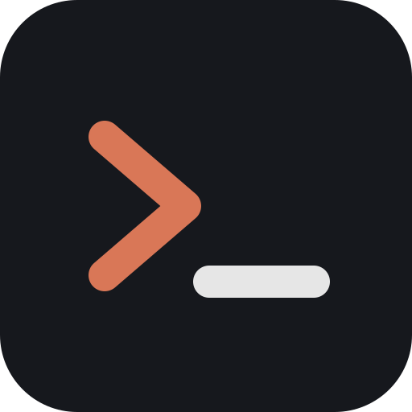
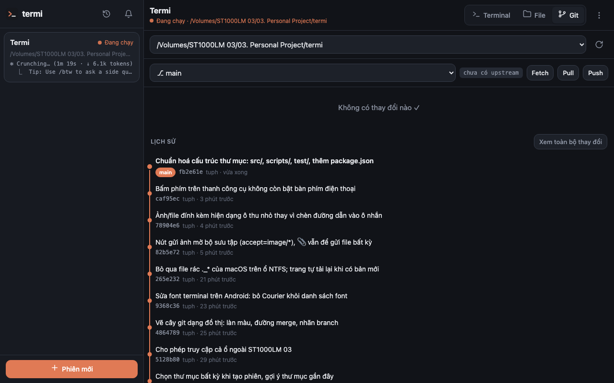
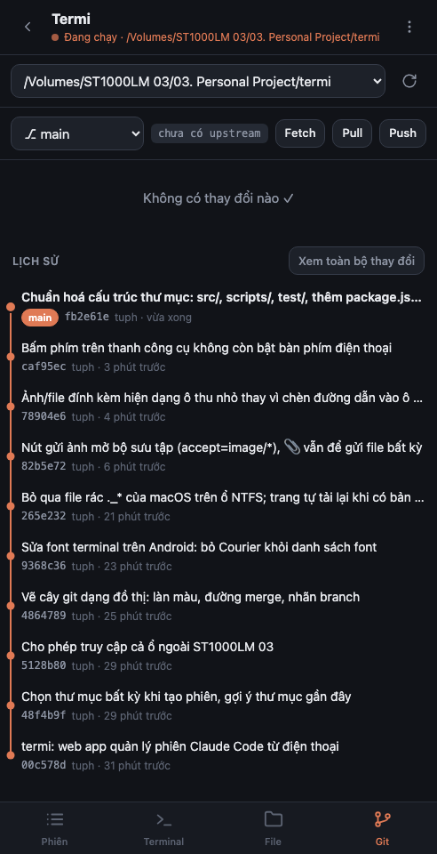
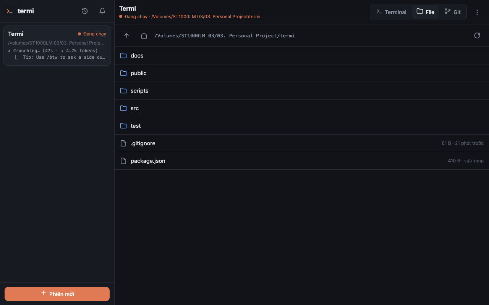
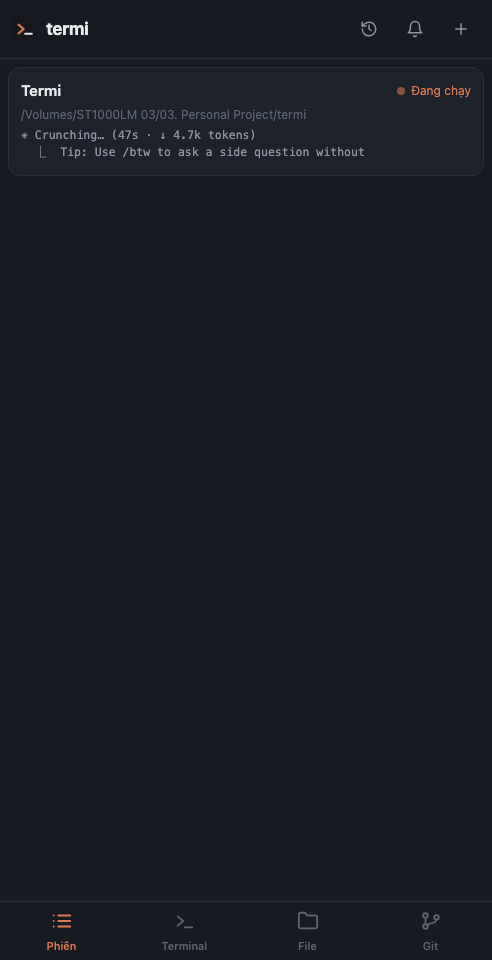
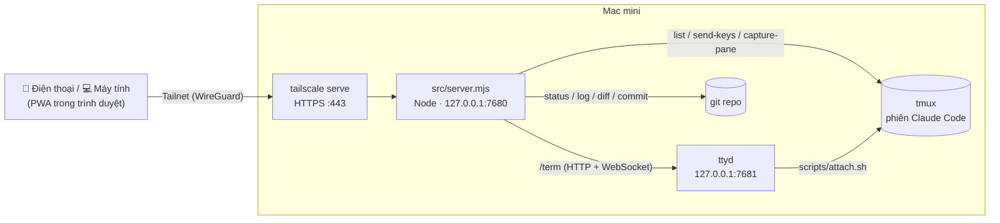

<div align="center">



# termi

**Điều khiển Claude Code trên Mac từ điện thoại: phiên không bao giờ mất, gõ tiếng Việt thoải mái, xem git ngay trên tay.**

<p>
  
  
  
  
  
</p>
<p>
  
  
  
  
  
  
</p>

<sub>Không framework · không cần <code>npm install</code> · không cần build</sub>

[English](README.md) | Tiếng Việt

</div>

---

## Vì sao có termi?

Dùng Claude Code CLI qua app SSH trên điện thoại rất khổ: mất mạng là mất phiên, bàn phím ảo không gõ được tiếng Việt, và không có cách nào xem nhanh git hay các phiên đang chạy.

termi là một web app nhỏ chạy ngay trên Mac của bạn, mở từ điện thoại (Android và iOS) qua Tailscale:

- **Phiên không mất:** mọi phiên Claude chạy trong `tmux`, app chỉ là lớp hiển thị. Tắt app, mất sóng, khoá máy thì phiên vẫn còn nguyên.
- **Gõ tiếng Việt:** ô nhắn dùng bàn phím gốc của điện thoại (Gboard, Laban Key…), gửi cả đoạn vào Claude bằng bracketed paste.
- **Biết Claude đang làm gì:** trạng thái *Đang chạy / Chờ bạn xác nhận / Rảnh* cho từng phiên, kèm thông báo đẩy khi Claude xong việc hoặc cần bạn duyệt lệnh.

## Ảnh chụp

<table>
  <tr>
    <td width="68%"></td>
    <td></td>
  </tr>
  <tr>
    <td></td>
    <td></td>
  </tr>
</table>

## Tính năng

| | Tính năng | Chi tiết |
|---|---|---|
| 🖥️ | **Nhiều máy** | Điều khiển mọi máy cùng tài khoản Tailscale có chạy termi (Mac, Linux, Windows qua WSL) từ một app: chọn máy ở đầu sidebar; thông báo từ mọi máy về một chỗ. |
| 🤖 | **Nhiều agent** | Claude Code, Codex, Antigravity (`agy`): chọn agent khi tạo phiên (chỉ hiện agent có cài), tự nhận ra phiên đang chạy agent nào, trạng thái và thông báo cho từng agent. |
| 🗂️ | **Quản lý phiên** | Màn hình chào tạo nhanh phiên Claude/Codex ở thư mục gần đây; danh sách xếp phiên cần chú ý lên đầu, tìm kiếm, nhóm theo thư mục, giữ lâu thẻ để đổi tên/đóng; tạo phiên ở bất kỳ thư mục nào, đổi tên, đóng phiên, mở lại hội thoại cũ của Claude (`claude --resume`) và Codex (`codex resume`). |
| 💻 | **Terminal** | Terminal đầy đủ (ttyd + xterm.js) gắn vào phiên tmux; vuốt để cuộn lịch sử, nút 📋 Chép mở chữ của phiên dạng văn bản để chọn và copy, chỉnh cỡ chữ A−/A+, hàng phím Esc, ⇧Tab, ^C, mũi tên… cho điện thoại; mất kết nối thì tự nối lại hoặc chạm để nối lại. |
| ⚡ | **Thao tác nhanh** | Một chạm gửi yêu cầu soạn sẵn cho Claude: tình trạng git, commit, push, tạo PR, merge PR (kiểm tra CI trước), review, chạy test, `/compact`; thao tác có rủi ro sẽ hỏi xác nhận. |
| ✍️ | **Ô nhắn** | Gõ tiếng Việt, gửi nhiều dòng; máy tính dùng Enter để gửi, Shift+Enter để xuống dòng. |
| 🖼️ | **Gửi ảnh và file** | Chọn từ bộ sưu tập hoặc file bất kỳ, hiện ô thu nhỏ; đường dẫn tự ghép vào tin nhắn khi gửi để Claude đọc được. |
| 📊 | **Usage** | Chip trên header: hạn mức gói của agent (Claude 5 giờ / 7 ngày, Codex), ngữ cảnh của phiên, CPU / RAM / ổ đĩa; chạm để xem chi tiết và lúc reset. |
| 🔔 | **Thông báo đẩy** | Web Push (VAPID, không cần dịch vụ trung gian) khi Claude xong việc hoặc đang chờ xác nhận. |
| 📁 | **Duyệt file** | Icon và màu theo loại file, đánh dấu file/thư mục đang thay đổi theo git; xem thư mục, đọc file và ảnh, xem trước Markdown như trên GitHub (kể cả sơ đồ Mermaid), chèn đường dẫn vào prompt. |
| 🌳 | **Git** | Cây commit dạng đồ thị (làn màu, đường merge, nhãn branch/tag); stage, bỏ stage, commit, fetch, pull, push, đổi branch; xem diff theo file hoặc theo commit. |
| 📱 | **Responsive** | Máy tính: sidebar và các tab. Điện thoại: thanh tab dưới. Giao diện Tự động / Sáng / Tối (nút ☀ ở đầu sidebar); giữ màn hình sáng khi đang mở app (Screen Wake Lock); cài được như app (PWA). |

## Kiến trúc



- **tmux** giữ toàn bộ trạng thái, nên server hay trình duyệt chết thì phiên vẫn còn.
- **Server** chỉ dùng thư viện chuẩn của Node (`http`, `child_process`, `crypto`…) và gọi `tmux`/`git` qua `execFile`, không qua shell.
- **Terminal** (ttyd) nằm sau server ở đường dẫn `/term`, cùng origin với app, nhờ vậy app chỉnh được cỡ chữ, cuộn bằng cảm ứng và tự kết nối lại.
- **Ra ngoài** chỉ qua `tailscale serve`: chỉ thiết bị trong tailnet của bạn truy cập được, không mở port ra internet.

## Yêu cầu

- macOS có [Homebrew](https://brew.sh)
- Node.js ≥ 24
- [Claude Code](https://claude.com/claude-code) đã đăng nhập
- Tài khoản [Tailscale](https://tailscale.com), đã bật **Serve/HTTPS** cho tailnet

## Cài đặt

Không cần clone code: script tải bản phát hành mới nhất, cài công cụ còn thiếu (tmux, ttyd, Node) và dịch vụ tự chạy.

```bash
# Repo riêng tư: cần GitHub CLI đã đăng nhập (brew install gh && gh auth login)
gh api repos/hoangtu0812/termi/contents/scripts/get.sh -H 'Accept: application/vnd.github.raw' | bash

# Repo công khai: một dòng, không cần đăng nhập
curl -fsSL https://raw.githubusercontent.com/hoangtu0812/termi/main/scripts/get.sh | bash
```

- Chạy lại đúng lệnh đó để **nâng cấp**. Mã chạy nằm ở `~/.termi/app/<phiên bản>` (ổ trong máy), `~/.termi/app/current` trỏ tới bản đang dùng; 2 bản gần nhất được giữ lại.
- Chọn thư mục termi được phép truy cập (mặc định `~`): đặt `TERMI_ROOTS="$HOME:/Volumes/Data"` trước lệnh. Khi nâng cấp, giá trị cũ được giữ.
- Cài một bản cụ thể: `TERMI_VERSION=v0.6.0`.
- Chỉ tải và giải nén, không cài dịch vụ: `TERMI_NO_SERVICE=1`.
- Cùng lệnh này chạy được trên **Linux** và **Windows (WSL2)**, xem mục bên dưới.

Script in ra địa chỉ dạng `https://<máy>.<tailnet>.ts.net`. Mở địa chỉ đó trên điện thoại (đã bật Tailscale), rồi:

- **Android (Chrome):** ⋮ → *Thêm vào màn hình chính*
- **iOS (Safari):** Chia sẻ → *Thêm vào MH chính* (bắt buộc nếu muốn nhận thông báo)

Gỡ cài đặt: `~/.termi/app/current/scripts/install.sh uninstall` (các phiên tmux vẫn được giữ).

## Thêm máy Windows hoặc Linux

Mỗi máy chạy termi riêng; termi trên máy bạn hay mở (ví dụ Mac mini) chuyển tiếp sang các máy khác qua Tailscale, nên trên điện thoại vẫn chỉ dùng **một app**.

**Windows** (termi chạy trong WSL2, vì cần `tmux`):

```powershell
# PowerShell (Admin): cài WSL + Ubuntu, khởi động lại máy nếu được yêu cầu
wsl --install -d Ubuntu
```

```bash
# Trong Ubuntu (WSL): bật systemd
printf '[boot]\nsystemd=true\n' | sudo tee /etc/wsl.conf
# PowerShell: wsl --shutdown   rồi mở lại Ubuntu

# Cài agent bạn dùng (claude, codex…) trong WSL, rồi:
gh api repos/hoangtu0812/termi/contents/scripts/get.sh -H 'Accept: application/vnd.github.raw' | bash
```

Tailscale cài trên Windows như bình thường; script tự gọi `tailscale.exe` để mở termi ra tailnet. Dự án nên để trong WSL (`~/…`) cho nhanh.

**Linux:** cài Tailscale, rồi chạy `scripts/install-linux.sh`.

Sau đó trên app, ô chọn máy ở đầu sidebar sẽ hiện máy mới (máy chưa cài termi hiện mờ).

## Hạn mức Claude trong mục Usage

Claude Code chỉ cung cấp hạn mức gói (5 giờ / 7 ngày) cho script **statusline**, nên termi có một script nhỏ lưu số liệu đó lại. Script giữ nguyên statusline bạn đang dùng (chuyển tiếp dữ liệu cho nó). Bạn tự chạy vì lệnh này sửa `~/.claude/settings.json` (có sao lưu `settings.json.termi-backup`):

```bash
npm run claude-usage        # gỡ: npm run claude-usage:off
# Từ termi trên điện thoại: gõ  ! npm run claude-usage  vào ô nhắn của phiên Claude đang ở thư mục termi
```

Theo tài liệu Claude Code, hạn mức chỉ có với gói Pro, Max và Ultra; mức đầy ngữ cảnh thì gói nào cũng có. Codex không cần cài gì: termi đọc thẳng từ `~/.codex/sessions`.

## Sử dụng nhanh

1. Bấm **+ Phiên mới**, chọn thư mục, tick *Chạy Claude ngay*.
2. Nhắn cho Claude ở ô dưới cùng; dùng 🖼️ / 📎 để gửi ảnh hoặc file.
3. Bấm 🔔 để bật thông báo; bấm 🕘 để mở lại hội thoại cũ.
4. Chuyển sang tab **Git** hoặc **File** để xem Claude đã sửa gì.

Trên Mac có thể vào cùng phiên bằng `tmux attach -t <tên>`. Thêm hàm sau vào `~/.zshrc` để tạo hoặc vào lại phiên nhanh:

```bash
tm() { tmux new -A -s "${1:-main}"; }
```

## Cấu trúc thư mục

```
termi/
├── src/
│   ├── server.mjs        # Điểm khởi động: đọc cấu hình, chạy app
│   ├── app.mjs           # HTTP server + API: phiên, file, git, push, upload
│   ├── config.mjs        # Biến môi trường và giới hạn
│   ├── store.mjs         # File trạng thái JSON, ghi nguyên tử theo hàng đợi
│   ├── validate.mjs      # Kiểm tra dữ liệu vào và đường dẫn
│   ├── text.mjs          # Xử lý chữ: cắt bớt, bỏ markdown, tên model
│   ├── errors.mjs        # Lỗi HTTP
│   ├── agents/           # Mỗi agent một adapter: Claude Code, Codex, Antigravity
│   ├── git/              # Chạy git, thao tác, parser, cây commit
│   └── tmux/             # Gọi tmux, đọc màn hình agent
├── public/               # PWA (giao diện tĩnh, không build)
│   ├── index.html        # Toàn bộ UI: HTML + CSS + JS
│   ├── sw.js             # Service worker cho thông báo đẩy
│   ├── manifest.json
│   └── icon.svg
├── scripts/
│   ├── install.sh        # macOS: dịch vụ launchd + tailscale serve
│   ├── install-linux.sh  # Linux/WSL: dịch vụ systemd --user + tailscale serve
│   ├── claude-statusline.mjs # lưu hạn mức + ngữ cảnh Claude cho mục Usage
│   └── attach.sh         # ttyd gọi để gắn vào phiên tmux theo tên
├── test/
│   └── *.test.mjs        # node:test, không cần thư viện
├── docs/                 # Tài liệu <TIỀN_TỐ>-v<X.Y>-<tên>.md, ảnh trong docs/assets/
├── plan/                 # Kế hoạch thực hiện PLAN-v<X.Y>-<tên>.md
├── AGENTS.md             # Quy tắc kỹ thuật (bản tiếng Việt: AGENTS.vi.md)
├── CHANGELOG.md          # Nhật ký thay đổi (bản tiếng Việt: CHANGELOG.vi.md)
└── package.json
```

## Phát triển

Làm việc trên mã nguồn (clone repo) và cài dịch vụ chạy thẳng từ thư mục đó:

```bash
git clone https://github.com/hoangtu0812/termi.git && cd termi && npm run service:install
```

Trước khi sửa code, đọc [AGENTS.vi.md](AGENTS.vi.md): quy tắc kiến trúc, không comment trong code, đặt tên tài liệu, commit và phát hành. Lộ trình refactor nằm trong [plan/](plan/).

- Commit, release và `CHANGELOG.md` viết bằng tiếng Anh ([Conventional Commits](https://www.conventionalcommits.org)); `CHANGELOG.vi.md` là bản tiếng Việt.
- Phát hành: chuyển mục `Unreleased` của hai changelog thành phiên bản mới, tăng `version` trong `package.json`, commit `chore(release): vX.Y.Z`, tạo bản phát hành `vX.Y.Z` trên GitHub, rồi `npm run release:asset` để đính file cài `termi-<version>.tgz` (script cài tải đúng file này).

```bash
npm test     # chạy test (node --test)
npm run check   # quy tắc: không comment, giới hạn kích thước, cú pháp, tên tài liệu
npm run verify  # check + test, giống CI
npm start    # chạy server ở 127.0.0.1:7680 (dừng dịch vụ launchd trước nếu trùng cổng)

# Khởi động lại server đang chạy dưới launchd sau khi sửa src/
launchctl kickstart -k gui/$UID/vn.termi.server
```

Sửa `public/index.html` không cần khởi động lại: trang đang mở sẽ tự tải lại khi thấy bản mới (trừ lúc bạn đang gõ dở).

| Biến môi trường | Mặc định | Ý nghĩa |
|---|---|---|
| `TERMI_ROOTS` | `$HOME` | Các thư mục gốc được phép truy cập, cách nhau bằng `:` |
| `TERMI_PORT` | `7680` | Cổng của server |
| `TERMI_TTYD_PORT` | `7681` | Cổng của ttyd |
| `TERMI_DATA` | `~/.termi` | Thư mục dữ liệu (khoá, đăng ký thông báo, file tải lên) |
| `TERMI_ALLOWED_USERS` | Chủ máy | Tài khoản Tailscale được phép vào, cách nhau bằng dấu phẩy |

Dữ liệu cục bộ nằm trong `~/.termi/`: khoá VAPID, danh sách thiết bị nhận thông báo và file tải lên (`uploads/`, không tự xoá). Log ở `~/Library/Logs/termi.*.log`.

## Bảo mật

termi cho quyền điều khiển shell trên máy của bạn, nên được thiết kế để **chỉ chạy trong tailnet riêng**:

- **Chỉ chủ máy được vào:** `tailscale serve` gắn danh tính người gửi (`Tailscale-User-Login`, không giả mạo được). termi chỉ nhận đúng tài khoản Tailscale sở hữu máy, hoặc danh sách trong `TERMI_ALLOWED_USERS` (cách nhau bằng dấu phẩy). Thiết bị gắn tag, máy được chia sẻ cho người khác và Funnel đều bị chặn. Không xác định được chủ máy thì chặn hết.
- **WebSocket terminal** chỉ nhận Origin của chính app (WebSocket không bị CORS bảo vệ). Khi chuyển tiếp sang máy khác, Origin chỉ được đổi sau khi đã kiểm tra.
- Trang không cho trang khác nhúng (`frame-ancestors 'self'`); `~/.termi` chỉ chủ tài khoản đọc được (700).
- Server và ttyd chỉ nghe trên `127.0.0.1`; đường vào duy nhất là `tailscale serve`. **Không bật Tailscale Funnel.**
- Chuyển tiếp sang máy khác (`/m/<máy>/…`) chỉ tới máy có trong tailnet của bạn và đang chạy termi, qua HTTPS của Tailscale.
- Chặn DNS rebinding (chỉ nhận Host là localhost hoặc `*.ts.net`) và CSRF (mọi POST phải có header `X-Termi`); ttyd bật kiểm tra origin.
- Mọi đường dẫn đều được `realpath` và phải nằm trong `TERMI_ROOTS`; tên phiên, branch và commit được kiểm tra bằng regex; lệnh gọi qua `execFile`.
- Chỉ phục vụ trực tiếp file ảnh, kèm header `Content-Security-Policy: sandbox`, để file trong repo (kể cả SVG) không chạy được script trên origin của app.
- Xem trước Markdown hiển thị trong `iframe` sandbox (không script, không cùng origin); thư viện [marked](https://marked.js.org) chỉ tải từ CDN khi mở file `.md`, có kiểm tra SRI. File có sơ đồ [Mermaid](https://mermaid.js.org) mới được bật script, và CSP chỉ cho chạy đúng file Mermaid (SRI) cùng đoạn khởi tạo (hash).

## Giới hạn đã biết

- Trạng thái Claude được đoán từ chữ trên màn hình terminal; Claude Code đổi giao diện thì có thể nhận sai.
- Khởi động lại máy làm tmux mất các phiên; termi lưu danh sách phiên 30 giây một lần và hiện nút **Khôi phục** (mở lại đúng hội thoại Claude/Codex). Agent không tự chạy khi chưa bấm.
- ttyd 1.7.7 không dọn client tmux của kết nối đứt đột ngột; termi tự khởi động lại ttyd khi có nhiều client kẹt (ưu tiên lúc không ai mở terminal), terminal tự nối lại.
- Cây git hiện 200 commit gần nhất, tối đa 10 làn.
- Trên iOS, thông báo chỉ hoạt động khi mở termi từ biểu tượng ở màn hình chính.
- Windows: WSL phải đang chạy thì máy đó mới hiện trong ô chọn máy (WSL có thể tự tắt khi không dùng).
- Antigravity (`agy`): chưa hỗ trợ mở lại hội thoại cũ; nhận diện dựa trên tên lệnh `agy`.
- Các máy trong termi tin nhau: một máy đã bị chiếm có thể trả nội dung độc hại qua đường chuyển tiếp `/m/<máy>/`, chạy trên địa chỉ của máy trung tâm. Chỉ thêm máy của chính bạn.
- termi chạy `git` trong repo bạn mở; repo không tin cậy có thể chứa cấu hình git chạy lệnh (ví dụ `core.fsmonitor`). Chỉ mở repo của bạn.

---

<div align="center"><sub>Làm bằng ☕ và <a href="https://claude.com/claude-code">Claude Code</a>.</sub></div>
